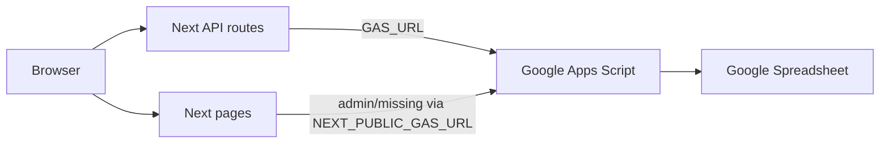

# PROJECT_MAP — Forklift Checklist

## 1. Tóm tắt

App **checklist an toàn xe nâng hàng ngày** (UI tiếng Việt) cho kho/vận hành.

- Tài xế mở link/QR theo xe (`/check?id=FL-xxxx`), chọn nhân viên, trả lời các mục PASS/FAIL/OTHER (câu hỏi lấy từ Sheet), gửi báo cáo.
- Quy tắc: **một xe nhiều người check trong ngày được**; **cùng một người không check lại cùng một xe trong ngày**.
- Admin xem dashboard `/`: KPI hôm nay, xe thiếu checklist, nhân viên đã check, chi tiết lỗi, biểu đồ nhiều ngày.
- Admin quản lý câu hỏi tại `/admin/questions` (thêm / sửa / soft-disable); source of truth là sheet **Questions**.
- **Không có DB trong repo** — persistence qua **Google Apps Script (GAS)** → **Google Sheets**.

| Layer | Stack |
|--------|--------|
| Framework | Next.js 16.1 (App Router), React 19, TypeScript |
| UI | Tailwind CSS 4, shadcn/Radix (`components/ui`), Lucide |
| Charts | Recharts |
| Backend | Next.js Route Handlers → GAS HTTP (`?action=...`) |

**Chạy:**

```bash
npm install
npm run dev      # http://localhost:3000
npm run build && npm start
npm run lint
```

Cần env: `GAS_URL`, `NEXT_PUBLIC_GAS_URL` (xem mục 6).

---

## 2. Cấu trúc thư mục

| Path | Vai trò |
|------|---------|
| `app/` | App Router: pages + API routes |
| `app/check/` | Form checklist tài xế |
| `app/admin/missing/` | Trang danh sách xe thiếu (client → GAS) |
| `app/admin/questions/` | Admin CRUD câu hỏi (qua Next API → GAS) |
| `app/api/` | Proxy server → GAS |
| `lib/` | Helper GAS client + `cn()` utils |
| `components/ui/` | shadcn primitives |
| `public/` | Static assets |
| `docs/` | Tài liệu dự án |
| `docs/code.gs` | **Bản GAS chính** (doGet/doPost, Questions, submit, reports) — paste vào Apps Script |
| `docs/Untitled.gs` | Utility `rebuildDailySummary()` |
| `docs/gas/` | Contract Questions + hướng dẫn deploy |

Schema DB không có trong repo; dữ liệu nằm trên Google Sheets.

---

## 3. Module map

### Pages

| Module | Path | Trách nhiệm | Phụ thuộc |
|--------|------|-------------|-----------|
| Dashboard | `app/page.tsx` | KPI, missing, drivers, chart, dialog chi tiết | `/api/admin/*`, Recharts, UI |
| Checklist | `app/check/page.tsx` + `CheckClient.tsx` | Form động theo câu hỏi active, status NV+xe, submit snapshot | `/api/employees`, `/api/questions`, `/api/forklift/status`, `/api/checklist/submit` |
| Admin questions | `app/admin/questions/page.tsx` | Thêm/sửa/vô hiệu hóa câu hỏi | `/api/questions`, `/api/admin/questions` |
| Admin QR A5 | `app/admin/qr/page.tsx` | Chọn xe active, in QR khổ A5 → `/check?id=` | `/api/forklifts`, `qrcode.react` |
| Admin missing | `app/admin/missing/page.tsx` | List xe thiếu (đơn giản) | `lib/gas.ts` → GAS `missing` (bypass Next API) |
| Layout | `app/layout.tsx` | Shell HTML, fonts Geist | `globals.css` |

### API (server → `process.env.GAS_URL`)

| Route | Method | GAS action |
|-------|--------|------------|
| `app/api/employees/route.ts` | GET | `employees` |
| `app/api/forklifts/route.ts` | GET | `forklifts` (+ optional `activeOnly`) |
| `app/api/questions/route.ts` | GET | `questions` (+ optional `activeOnly`) |
| `app/api/forklift/status/route.ts` | GET | `status` (+ `forkliftCode`, optional `employeeCode`) |
| `app/api/checklist/submit/route.ts` | POST | `submitChecklist` |
| `app/api/admin/questions/route.ts` | POST | `saveQuestion` / `setQuestionActive` (body.`op`) |
| `app/api/admin/missing/route.ts` | GET | `missing` |
| `app/api/admin/summary/route.ts` | GET | `summary` (+ `days`, mặc định 30) |
| `app/api/admin/drivers/route.ts` | GET | `drivers` (optional `date`) |
| `app/api/admin/driver-reports/route.ts` | GET | `driverReports` (+ `employeeCode`, optional `date`) |

### Lib

| File | Trách nhiệm |
|------|-------------|
| `lib/gas.ts` | `gasGet` / `gasPost` dùng `NEXT_PUBLIC_GAS_URL` |
| `lib/utils.ts` | `cn()` (clsx + tailwind-merge) |

---

## 4. Luồng chính

### A. Checklist submit

1. Mở `/check?id=<forkliftCode>`.
2. Parallel: `GET /api/employees` + `GET /api/questions?activeOnly=true`.
3. Chọn NV → `GET /api/forklift/status?forkliftCode&employeeCode` → GAS `status`.
4. Nếu `checked: true` → chặn form (NV này đã check xe này hôm nay).
5. Câu hỏi active (mặc định PASS); nếu có FAIL/OTHER → bắt buộc `issueDescription` (≥3 ký tự).
6. `POST /api/checklist/submit` → GAS `submitChecklist` với  
   `{ forkliftCode, employeeCode, employeeName, issueDescription, answers: [{ questionId, questionText, answer }] }`  
   (`questionText` = snapshot lúc gửi).

### B. Admin dashboard (`/`)

1. Parallel: `/api/admin/missing`, `summary`, `drivers`.
2. KPI ưu tiên danh sách missing (`total - missing.length`); sự cố lấy từ `daily_summary` (hôm nay); cảnh báo nếu `checked_count` lệch.
3. Click NV → `/api/admin/driver-reports` → dialog (PASS / HAS_ISSUE); `issueItems` hiện `questionText` (fallback `#questionId` / `#q`).
4. Chart từ `summary.data` (cột `checked_count`, đường `issue_count`).
5. Link tới `/admin/questions` và Google Sheet quản lý.

### C. Quản lý câu hỏi (`/admin/questions`)

1. `GET /api/questions` (tất cả, kể cả tắt).
2. Thêm/sửa → `POST /api/admin/questions` `{ op: "saveQuestion", ... }`.
3. Vô hiệu hóa / kích hoạt → `{ op: "setQuestionActive", questionId, active }`.
4. Soft-delete: `active=false` ẩn khỏi form mới; báo cáo cũ giữ snapshot.

Chi tiết sheet + mẫu GAS: [`docs/gas/QUESTIONS.md`](gas/QUESTIONS.md).

### D. Trang `/admin/missing`

Gọi GAS từ browser qua `NEXT_PUBLIC_GAS_URL` (`lib/gas.ts`), không qua `/api/admin/missing`.



---

## 5. Entry points

**Pages:** `/` (dashboard), `/check?id=...` (checklist), `/admin/qr` (in QR A5), `/admin/questions`, `/admin/missing`

**API:**

- `GET /api/employees`
- `GET /api/forklifts`
- `GET /api/questions`
- `GET /api/forklift/status`
- `POST /api/checklist/submit`
- `POST /api/admin/questions`
- `GET /api/admin/missing`
- `GET /api/admin/summary`
- `GET /api/admin/drivers`
- `GET /api/admin/driver-reports`

**External:** GAS web app URL; Spreadsheet (link trong `app/page.tsx`); tab `Questions`.

---

## 6. Dữ liệu & cấu hình

### Biến môi trường (không ghi secret)

| Tên | Dùng bởi |
|-----|----------|
| `GAS_URL` | Tất cả `app/api/**` (server) |
| `NEXT_PUBLIC_GAS_URL` | `lib/gas.ts` / `/admin/missing` (client) |
| `NEXT_PUBLIC_APP_URL` | Base URL trong QR in (`/admin/qr`); mặc định = origin trình duyệt |

Hai URL nên trỏ cùng một deployment GAS. Chưa có `.env.example` trong repo (`.env*` bị gitignore).

### Contract GAS (suy ra từ Next)

| Action | Response (xấp xỉ) |
|--------|-------------------|
| `employees` | `{ employees: [{ employeeCode, fullName }] }` |
| `forklifts` | `{ forklifts: [{ forkliftCode, name, active }] }` |
| `questions` | `{ questions: [{ questionId, sortOrder, text, active, updatedAt? }] }` |
| `saveQuestion` | `{ ok, question }` |
| `setQuestionActive` | `{ ok, question }` |
| `status` | `{ checked: boolean, date?: string }` |
| `submitChecklist` | success + optional `date`; lỗi `{ error }`; answers snapshot; ghi cột `answersJson` + 11 ô legacy |
| `missing` | `{ date, total, checked, missing: [{ forkliftCode, name? }] }` |
| `summary` | `{ days?, data: [{ date, checked_count, issue_count }] }` — sheet concept `daily_summary` |
| `drivers` | `{ date, totalDrivers, drivers: [{ employeeCode, employeeName, count }] }` |
| `driverReports` | `{ ..., reports: [...] }` với `issueItems: [{ questionId?, questionText?, q?, answer }]` |

Sheet `Questions` + deploy: [`docs/gas/QUESTIONS.md`](gas/QUESTIONS.md). Implement: [`docs/code.gs`](code.gs). Seed khuyến nghị `Q01`…`Q11`.

---

## 7. Ghi chú tiếp quản

- README / metadata (`app/layout.tsx`) vẫn boilerplate create-next-app.
- **Dual GAS URL** (`GAS_URL` vs `NEXT_PUBLIC_GAS_URL`); `/admin/missing` bypass API proxy.
- Dependency khai báo nhưng **chưa dùng**: `zod`, `google-spreadsheet`.
- GAS trong repo: [`docs/code.gs`](code.gs) — nhớ **Deploy** web app sau khi paste; seed sheet `Questions` trước khi dùng admin/form.
- Không có auth/roles trong Next (ai có URL đều mở được admin/check).
- Dữ liệu cũ: soft-delete + `answersJson` snapshot; report cũ không có JSON thì map `1→Q01` … khi đọc.
- Xử lý lỗi không đồng đều giữa các route; KPI có cảnh báo mismatch `daily_summary` vs missing list.
- `CheckClient` dùng `useSearchParams()` — cần lưu ý Suspense boundary khi build Next.
- Chưa có test / `.env.example`.
